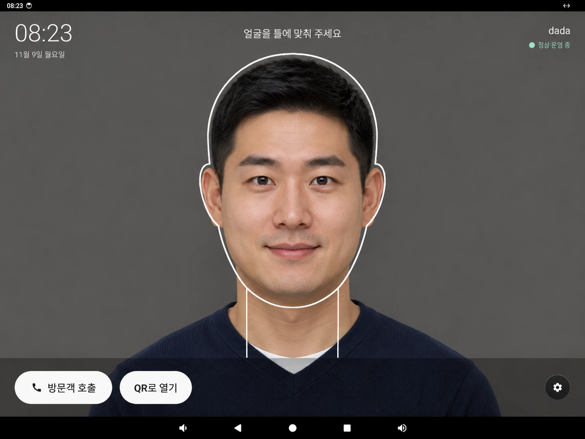

# FaceGate

얼굴인식 스피드게이트 출입 시스템입니다. 직원이 게이트 앞에 서면 얼굴을 알아보고, 출입 권한이 있으면 게이트를 열어 줍니다. 게이트 서버, 관리자 웹, 안드로이드 게이트 단말을 혼자 설계하고 만들었습니다.

## 게이트 단말 화면



게이트 단말의 대기 화면입니다. 가운데 틀에 얼굴을 맞추면 단말이 알아보고 판정합니다. 사진 속 인물은 예시 이미지입니다.

## 만들게 된 이유

사옥 입구에 스피드게이트를 놓기로 했는데, 게이트 업체는 시공과 배선까지만 맡는다고 했습니다. 업체가 주는 건 게이트 본체와 열림 신호 단자가 전부라서, 얼굴을 알아보는 것부터 들어가도 되는 사람인지 판단하고, 문을 열고, 기록을 남기는 것까지 전부 제가 만들어야 했습니다.

목표는 출근 시간에 카드를 꺼내지 않고 얼굴만으로 멈추지 않고 지나가는 것이었습니다. 얼굴이 보이고 1초 안에 문이 열리는 걸 목표로 잡았습니다.

기성 출입통제 제품도 알아봤지만 두 가지가 걸렸습니다. 얼굴 사진이 사내망 밖으로 나가면 안 됐고, 권한 그룹이나 시간표, 생체정보 동의서, 방문객 호출 같은 회사 규칙을 우리 식대로 맞출 수 있어야 했습니다. 마침 다른 현장에서 쓰던 얼굴인식 AI 서버가 있어서, 그 AI가 쓰는 API 경로와 형식을 그대로 받는 서버를 만들었습니다. 덕분에 AI 프로그램은 서버 주소와 키만 바꿔서 붙일 수 있었습니다.

## 동작 방식

```
[게이트 단말] ──RTSP 영상──▶ [AI 서버] ──appear(누구인지)──▶ [게이트 서버] ──릴레이──▶ 게이트 열림
      ▲                                                          │
      └──────────────── WebSocket 판정 결과 (화면, 불빛, 소리) ────┘
                                                                 │
                                                  [관리자 웹] 직원, 권한, 기록, 설정

단말 안 인식을 켜면 단말이 직접 얼굴을 알아보고 서버에 appear를 보냅니다 (AI 서버 없이)
```

문을 열지 말지는 항상 게이트 서버가 정하게 했습니다. 누가 단말을 떼어 가거나 조작해도 문이 열리면 안 되기 때문입니다. 얼굴이 잘 안 될 때는 미리 등록한 핸드폰을 단말에 대거나 QR을 비춰서 열 수 있고, 핸드폰에 앱을 깔 필요는 없습니다.

## 시행착오

처음 생각대로 되지 않아서 바꾼 것들입니다.

| 부딪힌 문제 | 처음 방식 | 바꾼 방식 |
|---|---|---|
| 게이트 앞을 지나가기만 해도 인식될 수 있었다 | 얼굴이 보이면 바로 판정 | 얼굴이 화면 높이의 25% 이상이고, 가운데에 있고, 정면이고, 그게 연속 3장일 때만 '단말 앞에 선 사람'으로 봤다. 여러 명이면 가장 큰 얼굴 한 명만 |
| 서 있는 동안 같은 사람 결과가 계속 들어왔다 | 들어올 때마다 판정 | 같은 사람이 계속 보이는 동안은 출입 한 건으로 합쳤다. 문이 여러 번 열리지 않게 |
| 단말 안에서 인식을 돌리니 CPU가 쉬지 못했다 | AI팀이 준 기본 설정 (얼굴 찾기 640) | 어차피 단말 바로 앞의 큰 얼굴만 보면 되니 320으로 줄였다. 장면 한 장이 1.2초에서 0.28초로, 앱 CPU가 49%에서 18%로 |
| 측정값이 실제보다 몇 배 나쁘게 나왔다 | 개발용(디버그) 빌드로 측정 | 디버그 빌드는 사진을 숫자로 바꾸는 부분이 유난히 느렸다. 그 뒤로 속도는 릴리스 빌드로만 쟀다 |
| CPU 가속 라이브러리(XNNPACK)를 켜니 앱이 죽었다 | 가속 라이브러리 사용 | 기본 CPU 실행으로 돌렸다. 단말 NPU(RKNN)는 다음에 붙일 계획 |
| PC AI와 단말이 둘 다 인식하면 기록이 두 번 남았다 | 둘 다 켜 둠 | 관리자 웹 설정에 '얼굴 인식 위치'를 두고 한 곳만 고르게 했다 |
| 핸드폰을 카드처럼 대려면 전용 앱이나 지갑 제휴가 있어야 했다 | NFC 스티커, 아니면 핸드폰 앱 | 역할을 거꾸로 했다. 단말이 NFC 태그인 척(HCE)하고 핸드폰이 그걸 읽어 브라우저로 연다. 주소는 60초 동안 한 번만 쓸 수 있고, 아이폰을 생각해 QR도 같이 뒀다 |
| 소속별로 게이트를 붙이는 방식으로는 임원, 팀장 같은 예외를 다루기 어려웠다 | 소속에 게이트를 붙임 | 기성 출입통제 제품처럼 권한 그룹(게이트 묶음, 시간표, 구성원)으로 바꿨다 |
| 생체정보 동의를 관리자가 체크박스로 대신 누르고 있었다 | 관리자 확인란 | 등록하는 직원 본인이 동의서 전문을 끝까지 보고 직접 누르게 했다 |
| 공용 서버 PC에서 컨테이너가 1000번 사용자로 돌면 그 계정 주인이 얼굴 사진을 볼 수 있었다 | 일반 사용자 1000번 | 출입 서버 전용 시스템 계정을 만들고, 데이터 폴더는 그 계정만 읽게 했다 |

결정할 때마다 날짜와 번호(D-xx)를 붙여 [결정 로그](docs/07_미결사항_결정로그.md)에 남겨 뒀습니다.

## 성과 지표

개발 PC와 실제 단말(RK3576, Android 14)에서 직접 잰 값입니다. 아직 시범 운영 전이라 표본이 많지 않습니다.

| 과제 | 성과 지표 | 결과 |
|---|---|---|
| 얼굴 출입 | 사람이 보인 시각부터 문 열림까지 (목표 1초) | PC AI 경로 중앙값 1.7초, 90%가 2.3초 안 (허가 19건. 보인 시각이 초 단위로만 남아 최대 1초 오차). 목표에는 아직 못 미침 |
| 얼굴 출입 | 게이트 서버 판정과 개방 처리 시간 | 인식 결과를 받고 2ms 안에 문 열림 신호 |
| 단말 안 인식 | 단말이 결과를 보낸 뒤 문 열림까지 | 0.3초 (직접 서서 확인, 유사도 0.71) |
| 단말 안 인식 | 장면 한 장 처리 시간 | 얼굴 찾기 640: 1.1~1.25초 → 320: 0.28초 (사람이 서면 인식에 0.14초 더) |
| 단말 안 인식 | 앱 CPU, 온도 (10분 연속) | 640: 49%, 85도 → 320: 18~20%, 66~77도 (인식을 끄면 8%, 63도) |
| 인식 정확도 | 저장해 둔 장면 44장을 단말에서 다시 판정 | 등록자 11장 중 7장 인식. 나머지 4장은 역광으로 흐려서 기준값(0.40)을 못 넘었다. 미등록자를 직원으로 잘못 연 경우 0건 (미등록자 장면은 1장뿐) |
| 대체 수단 | 핸드폰으로 열 때 필요한 설치 | 앱 0개 (브라우저와 NFC, 또는 카메라만) |
| 배포 | 단말 앱 크기 | 213MB → 163MB (단말과 에뮬레이터용 라이브러리만 남김) |
| 품질 | 자동 시험 | 서버 260개, 관리자 웹 159개, 단말 29개 |

## 앞으로 할 것

- 여러 사람이 같이 있을 때와 역광에서 정확도를 더 재고 기준값 정하기
- 단말 NPU(RKNN)로 옮겨서 CPU 부담 더 줄이기
- 얼굴 인식 모델의 학습 가중치가 비상업 연구용이라, 실제 운영 전에 사용 허가를 받거나 다른 모델로 바꾸기 (모델 파일은 저장소에 넣지 않았습니다)
- 얼굴 사진 저장 암호화, 머문 시간(disappear) 기록, 정식 릴리스 서명

## 저장소 구조

```
docs/                    설계 문서 01~12
contracts/examples/      시스템 간 메시지 예시 (서버, 단말 시험이 함께 읽음)
services/gate-server/    게이트 서버 — TypeScript, Node.js 24, Express 5, SQLite
apps/admin-web/          관리자 웹 — React 19, Vite
apps/terminal-android/   게이트 단말 — Kotlin (app + streaming 모듈, 얼굴 인식은 app의 face 패키지)
```

## 문서 (docs/)

| No | 문서 | 내용 |
|---|---|---|
| 01 | [프로젝트 계획서](docs/01_프로젝트계획서.md) | 목적, 범위, 하위 프로젝트, 일정 단계 |
| 02 | [요구사항 정의서](docs/02_요구사항정의서.md) | 기능, 비기능 요구사항 (ID 부여) |
| 03 | [시스템 아키텍처 설계서](docs/03_시스템아키텍처설계서.md) | 구성도, 컴포넌트, 기술 스택, 장애 대응 |
| 04 | [인터페이스 정의서](docs/04_인터페이스정의서.md) | AI 서버 API, 단말 API, 게이트 신호 |
| 05 | [화면 설계서](docs/05_화면설계서.md) | 게이트 단말 화면, 관리자 웹 화면 |
| 06 | [데이터베이스 설계서](docs/06_데이터베이스설계서.md) | 테이블 정의 |
| 07 | [미결사항 및 결정 로그](docs/07_미결사항_결정로그.md) | 질문, 결정 기록 |
| 08 | [게이트 업체 질의서](docs/08_게이트업체질의서.md) | 게이트 업체에 보낼 질문 |
| 09 | [AI 프로그램 분석](docs/09_AI프로그램_분석.md) | 얼굴인식 AI 구조, 게이트용 변경점, 라이선스 주의 |
| 10 | [1차 개발 계획](docs/10_1차개발계획.md) | 1차 하위 프로젝트 순서와 일정 |
| 11 | [설치와 운영](docs/11_설치운영.md) | 서버 PC 설치, 폴더 권한, HTTPS, Docker, 백업 |
| 12 | [검증 지도](docs/12_검증지도.md) | 기능별 확인 방법과 증거 |

시작하기 전에 시중 제품을 조사한 노트는 [research-notes.md](research-notes.md)에 있습니다.
